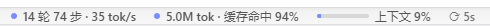

# zcode-token-bar

English | [简体中文](README.md)

A **live token usage bar** for the ZCode desktop app: it floats right below the chat input box and shows, for the current session, turns / steps, output speed, total tokens, cache hit rate and context usage. Click any pill for details.



> **Unofficial.** Not affiliated with Z.ai or DeepSeek. Use at your own risk.
> This tool does **not** modify the ZCode installation. It only injects the bar into the
> renderer while a local debugging port is open; all data comes from **read-only** queries
> against the local SQLite database. Nothing leaves your machine.

## Features

| Pill | Shows | Click for |
|---|---|---|
| Activity | `N turns M steps · X tok/s` | model time / tool time / avg TTFT / output speed |
| Usage | `X tok · cache hit P%` | exact totals + uncached input / cache read / cache write / output |
| Context | `Context P%` + mini meter | latest-turn context / limit / ratio, with limit source |

- Follows the input box in real time as it grows with long content (ResizeObserver); floats above the composer when the window is too short
- Context limit is resolved per current model (provider config → same-model catalog → 1M default); overridable via environment variable
- Crash-safe: uncaught exceptions are logged only, the controller keeps running

## Install (Windows)

Requirements: Node.js 22+, Windows 10+.

```cmd
git clone https://github.com/Angelholl/zcode-token-bar.git
cd zcode-token-bar
start.cmd
```

> **Note:** if ZCode is already running, `start.cmd` asks to kill it and relaunch with the
> debugging port — **save unfinished work in ZCode first**. The bar appears below the input
> box about 2 seconds after the relaunch.

Stop: `stop.cmd`.

## Uninstall

1. Run `stop.cmd` to stop the controller;
2. Launch ZCode normally (without the debug port) and the bar is gone;
3. Delete this folder. The tool never writes into the ZCode install directory — nothing left behind.

## Configuration (environment variables)

| Variable | Default | Description |
|---|---|---|
| `ZSTB_PORT` | `9333` | CDP debugging port, must match ZCode's launch flag |
| `ZSTB_INTERVAL` | `5000` | Data refresh interval (ms); bar repositioning is event-driven and unaffected |
| `ZSTB_CONTEXT_LIMIT` | auto | Force the context limit (tokens) |
| `ZSTB_DB` | `~/.zcode/cli/db/db.sqlite` | Database path |

## How it works

```
db.sqlite (read-only) ──5s poll──> Node controller ──CDP WebSocket──> injected bar in renderer
      turn_usage / model_usage / tool_usage            Runtime.evaluate + addBinding
```

The controller queries ZCode's local database read-only every 5 seconds and pushes stats
into the renderer over CDP (`--remote-debugging-port`). On the page side a ResizeObserver
tracks the input box and composer card, so repositioning is event-driven and instant. The
page can wake the controller through bindings (session switch / manual refresh).

## License

MIT. Third-party attributions: [THIRD_PARTY_NOTICES.md](THIRD_PARTY_NOTICES.md)
(stats pills UI adapted from DeepSeek Harness, MIT; ideas inspired by ZcodeTokbar).
