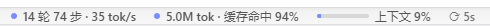

# zcode-token-bar

[English](README.en.md) | 简体中文

为 ZCode 桌面版提供**实时 Token 用量统计条**：悬浮在聊天输入框下方，显示当前会话的轮次 / 步骤、输出速度、Token 总量、缓存命中率与上下文占用，点击胶囊可查看明细。



> **Unofficial.** 与 Z.ai / DeepSeek 无关联。使用风险自负。
> 本工具**不修改 ZCode 安装文件**，仅在本机调试端口开启时向渲染层注入统计条；
> 所有数据来自本地 SQLite **只读**查询，不经网络外发。

## 功能

| 胶囊 | 内容 | 点击明细 |
|---|---|---|
| 活动胶囊 | `N 轮 M 步 · X tok/s` | 模型用时 / 工具用时 / TTFT 平均 / 输出速度 |
| 用量胶囊 | `X tok · 缓存命中 P%` | 精确总量 + 未命中输入 / 缓存读 / 缓存写 / 输出 分桶 |
| 上下文胶囊 | `上下文 P%` + 迷你进度条 | 最近一轮上下文 / 上限 / 占比，上限来源标注 |

- 长内容输入框增高时统计条实时跟随（ResizeObserver），窗口过矮自动改浮在输入框上方
- 上下文上限按当前模型自动识别（provider 配置 → 同模型目录 → 默认 1M），可用环境变量强制指定
- 崩溃自愈：未捕获异常仅记录日志，控制器不退出

## 安装（Windows）

要求：Node.js 22+，Windows 10+。

```cmd
git clone https://github.com/Angelholl/zcode-token-bar.git
cd zcode-token-bar
start.cmd
```

> **注意**：若 ZCode 正在运行，`start.cmd` 会询问是否结束 ZCode 并以调试端口重启——**请先保存 ZCode 里未完成的工作**。重启后约 2 秒，统计条出现在输入框下方。

停止：`stop.cmd`（按 `%USERPROFILE%\.zcode\tools\session-stats-cdp\controller.pid` 停控制器，不动 ZCode 本身）。

### 开机自启

运行一次：

```cmd
boot-start.cmd
```

即可把「ZCode（带调试端口）+ 统计控制器」注册进启动文件夹（`zcode-token-bar.lnk`），开机登录后同步启动。`boot-start.cmd` 非交互且幂等：ZCode 未运行才带 `--remote-debugging-port=9333` 拉起，控制器未运行才拉起，重复运行安全。

注意：开机后若你抢先手动打开了 ZCode（不带调试端口），该次会话统计条不会出现——此时手动跑一次 `start.cmd` 即可。卸载自启：删除启动文件夹里的 `zcode-token-bar.lnk`。

### 不想动手？让 AI 代劳

把下面的提示词整段复制到 ZCode 对话框发送即可：

```text
请帮我安装 zcode-token-bar 悬浮统计条：
1. 克隆 https://github.com/Angelholl/zcode-token-bar 到合适目录；
2. 运行其中的 start.cmd（如果需要重启 ZCode，先提醒我保存未完成的工作）；
3. 完成后确认统计条出现在输入框下方，并告诉我 stop.cmd 的位置。
```

## 卸载

1. 运行 `stop.cmd` 停止控制器；
2. 直接从开始菜单/正常方式启动 ZCode（不带调试参数），统计条即消失；
3. 删除本仓库目录即完成卸载。本工具不写入 ZCode 安装目录，无残留。

## 配置（环境变量）

| 变量 | 默认 | 说明 |
|---|---|---|
| `ZSTB_PORT` | `9333` | CDP 调试端口，需与 ZCode 启动参数一致 |
| `ZSTB_INTERVAL` | `5000` | 数据刷新周期（毫秒）；位置跟随是实时的，不受此值影响 |
| `ZSTB_CONTEXT_LIMIT` | 自动识别 | 强制指定上下文上限（token 数） |
| `ZSTB_DB` | `~/.zcode/cli/db/db.sqlite` | 数据库路径 |

## 原理

```
db.sqlite (只读) ──5s 轮询──> Node 控制器 ──CDP WebSocket──> ZCode 渲染层注入统计条
      turn_usage / model_usage / tool_usage            Runtime.evaluate + addBinding
```

控制器每 5 秒只读查询 ZCode 本地数据库，通过 CDP（`--remote-debugging-port`）把统计
推送到渲染层；页面端用 ResizeObserver 跟踪输入框与卡片尺寸，位置重锚是事件驱动、
即时生效的。页面可通过 binding 反向唤醒控制器（会话切换 / 手动刷新）。

## License

MIT. 第三方署名见 [THIRD_PARTY_NOTICES.md](THIRD_PARTY_NOTICES.md)
（统计胶囊 UI 参考/部分派生自 DeepSeek Harness，MIT；思路参考 ZcodeTokbar）。
